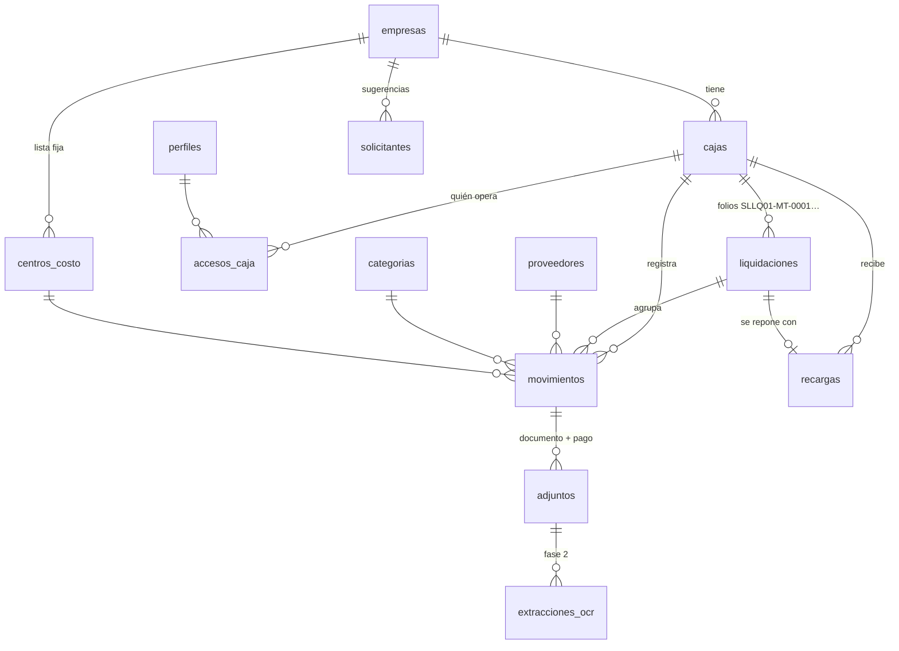

# Modelo de datos — Factudex

> Estado: **propuesta para aprobación**. SQL completo en
> [`supabase/migrations/20260925000000_esquema_inicial.sql`](../supabase/migrations/20260925000000_esquema_inicial.sql),
> datos de demo en [`supabase/seed.sql`](../supabase/seed.sql).

## Diagrama

## Principios

1. **El saldo no se guarda, se calcula.** `saldo = Σ recargas − Σ movimientos no anulados`
   (vista `v_saldo_cajas`). Así un gasto descuenta al instante y no hay saldos desincronizados.
2. **El estado Pendiente/Completo es un campo del movimiento**, mantenido por un trigger:
   pasa a `completo` cuando tiene el **documento** (factura, boleta, recibo por honorarios,
   planilla de movilidad, comprobante de egreso…) **y** la **constancia del pago** (captura de
   Yape, voucher de transferencia…). **Excepción: pago en efectivo** — basta el documento
   (boleta física, comprobante de egreso…), porque no existe constancia digital.
3. **Solo se liquidan movimientos completos.** Un pendiente no tiene plazo máximo: al cerrar la
   liquidación se traslada automáticamente a la siguiente, y así hasta que se complete.
4. **Nada se borra.** Los movimientos se *anulan* con motivo; las liquidaciones cerradas
   congelan sus movimientos (solo se les pueden seguir adjuntando documentos).
5. **Las transiciones de liquidación solo ocurren por RPC** (`cerrar_liquidacion`,
   `revisar_liquidacion`) y por el registro de la recarga; el cliente no puede cambiar `estado` directo.
6. **Montos** en `numeric(12,2)` (soles). **Fechas de negocio** en `date`, zona `America/Lima`.

## Tablas

### `empresas`
| Campo | Tipo | Nota |
|---|---|---|
| id | uuid PK | |
| codigo | text único | `SL`, `SIPE` — identifica la empresa en la app (tema de color) |
| sigla | char(2) único | `SL`, `SP` — va en el folio |
| nombre_corto / razon_social | text | "San Lorenzo" / "Compañía San Lorenzo S.A.C." |
| ruc | char(11) | opcional |
| color_primario / color_acento | text `#RRGGBB` | tema dinámico del HUD |
| activa | bool | |

### `cajas`
| Campo | Tipo | Nota |
|---|---|---|
| id | uuid PK | |
| empresa_id | FK empresas | |
| numero | smallint | N° de caja dentro de la empresa (1, 2…), único por empresa — va en el folio como `01` |
| area | text | sigla del área: `MT` Mantenimiento, `OP` Operaciones, `GE` General… — va en el folio |
| nombre | text | "Mantenimiento" |
| umbral_alerta | numeric | aviso cuando el saldo baja de aquí (ej. S/ 200) |
| responsable_id | FK perfiles | quien la liquida normalmente |

### `perfiles` (usuarios) y `accesos_caja` (roles)
`perfiles` es 1–1 con `auth.users` y se crea solo al registrarse (trigger).

| Rol | Alcance | Puede |
|---|---|---|
| `admin` | global (`perfiles.rol`) | todo: empresas, cajas, usuarios, maestros |
| `aprobador` | por caja (`accesos_caja.rol`) | lo del registrador + aprobar/observar liquidaciones + registrar recargas |
| `registrador` | por caja | registrar movimientos, adjuntar comprobantes, cerrar liquidación |
| `lector` | por caja | solo ver (ej. gerencia) |

Una persona puede ser registradora en una caja y aprobadora en otra. **Esto resuelve el
problema de origen**: si la persona habitual falta, se le da acceso a otra en minutos.

### `proveedores` (maestro compartido entre SL y SIPE — confirmado)
| Campo | Tipo | Nota |
|---|---|---|
| tipo_doc | enum `RUC` \| `DNI` \| `CE` \| `OTRO` | |
| num_doc | text | RUC validado (11 dígitos, prefijo 10/15/17/20), DNI 8 dígitos. Único con `tipo_doc` |
| razon_social | text | |
| nombre_comercial | text | ej. "COVISOL - Peaje Chicama" |

Índice trigram sobre `razon_social + nombre_comercial + num_doc` para el autocompletado
("buscar por nombre o RUC"). Cualquier usuario puede crear un proveedor nuevo desde el registro;
solo admin edita.

### `categorias`
`nombre`, `orden`, `empresa_id` (null = global). Semilla: Peajes, Combustible, Repuestos y
ferretería, Llantas, Alimentación, Movilidad, Útiles de oficina, Servicios, Otros.

### `centros_costo` (lista fija por empresa)
`empresa_id`, `codigo` (único por empresa), `nombre`, `activo`, `orden`. Solo admin la
mantiene; en el registro se elige de un desplegable con **"General" preseleccionado** (no es
obligatorio). Un trigger impide usar un centro de costo de otra empresa o inactivo.
El seed trae una lista **de ejemplo**; falta cargar la real.

### `solicitantes` (lista por empresa)
`empresa_id`, `nombre`, `area` (opcional), `activo`. Solo sugiere nombres en el campo Solicitante
del registro; el movimiento guarda el nombre como texto (así sale en la liquidación).

### `movimientos` (gastos)
| Campo | Tipo | Nota |
|---|---|---|
| caja_id | FK | no se puede cambiar después |
| liquidacion_id | FK | **automático**: la liquidación abierta de la caja (se crea si no hay). Si sigue pendiente al cerrar, pasa a la siguiente |
| fecha | date | fecha del gasto |
| solicitante | text | quién pidió el gasto |
| proveedor_id | FK, nullable | null = "Por definir" |
| categoria_id | FK, nullable | null = "Sin categorizar" |
| centro_costo_id | FK centros_costo, nullable | lista fija de la empresa de la caja |
| detalle | text | "Peaje pesado 3 ejes" |
| monto | numeric > 0 | |
| tipo_documento | enum `factura` \| `boleta` \| `rxh` \| `planilla_movilidad` \| `comprobante_egreso` \| `otro`, nullable | null = aún no se sabe |
| serie_numero | text | ej. `F001-00012345` |
| medio_pago | enum `efectivo` \| `yape` \| `plin` \| `transferencia` \| `otro`, nullable | **independiente** del tipo de documento. En `efectivo` no se exige constancia de pago |
| operacion_pago | text, opcional | N° de operación de Yape/Plin/transferencia (sale en la columna YAPE/PLIN del Excel) |
| estado | enum `pendiente` \| `completo` | trigger (`fx_estado_movimiento`): documento + pago, o documento solo si es efectivo |
| origen | enum `manual` \| `compartido` \| `ocr` | de dónde vino (métrica de adopción) |
| anulado / motivo_anulacion | | en vez de borrar |
| creado_por, created_at, updated_at | | auditoría |

### `adjuntos`
Archivos en Supabase Storage, bucket privado `comprobantes`, ruta
`<caja_id>/<movimiento_id>/<uuid>.<ext>` (el primer segmento permite aplicar RLS en Storage).

| Campo | Nota |
|---|---|
| tipo | `documento` (factura, boleta, planilla…) \| `pago` (captura Yape, voucher…) \| `otro`. Hacen falta `documento` **y** `pago` para completar (en efectivo, solo `documento`) |
| storage_path, mime_type, tamano_bytes | JPG/PNG/WEBP/HEIC/PDF, máx. 10 MB |

Un movimiento puede tener varios adjuntos (ej. captura de Yape hoy + factura la próxima semana).
Cuando el movimiento ya está en una liquidación cerrada, sus adjuntos no se pueden quitar.

### `liquidaciones`
| Campo | Nota |
|---|---|
| correlativo, folio | automáticos por caja, formato `NNLQXX-AREA-0001`: sigla de empresa + `LQ` + n° de caja (2 dígitos) + área + correlativo. Ej. `SLLQ01-MT-0001`, `SLLQ02-OP-0001`, `SPLQ01-GE-0001` |
| estado | ver ciclo abajo |
| fecha_inicio, fecha_cierre | |
| saldo_inicial | saldo final de la liquidación anterior (0 en la primera). Se fija al cerrar la anterior |
| total_ingresos | snapshot al cerrar: depósitos del periodo (recargas con `liquidacion_ingreso_id` = esta) |
| total_gastado | snapshot al cerrar = suma de los movimientos **completos** liquidados (EGRESO) |
| saldo_final | snapshot al cerrar = saldo_inicial + total_ingresos − total_gastado (**POR REEMBOLSAR**) |
| cerrada_por/en, aprobada_por/en, observaciones | trazabilidad de quién hizo qué |

Solo puede haber **una liquidación abierta por caja** (índice único parcial).

```mermaid
stateDiagram-v2
  [*] --> abierta : primer gasto
  abierta --> en_revision : cerrar_liquidacion()<br/>(= solicitud de recarga; se abre la siguiente<br/>y los pendientes pasan a ella)
  en_revision --> aprobada : revisar_liquidacion(true)
  en_revision --> observada : revisar_liquidacion(false)
  observada --> en_revision : corregir y re-cerrar
  aprobada --> repuesta : insert en recargas
  repuesta --> [*]
```

Reglas del cierre (`cerrar_liquidacion`):
- Exige al menos un movimiento completo.
- Los movimientos pendientes **no** se liquidan: se trasladan a la liquidación abierta siguiente.
- `revisar_liquidacion` no permite aprobar si hubiera algún movimiento sin documento y pago.

La vista `v_liquidaciones` añade `total_actual`, `total_liquidable` (solo completos),
`num_movimientos`, **`num_incompletos`** (en la abierta se pintan en rojo: no entrarán al cierre),
`ingresos_actual` y `saldo_final_actual` (el "por reembolsar" en vivo de la abierta).

Ejemplo verificado con los números de `pruebaliquidacion.xlsx`: la liquidación 1 cierra con
S/ 217.80; la 2 recibe S/ 217.80 de saldo inicial + S/ 1,000.00 de depósito − S/ 915.20 de
egresos = **S/ 302.60 por reembolsar**, que pasa como saldo inicial a la 3.

### `recargas` (entradas)
| Campo | Nota |
|---|---|
| tipo | `apertura` (fondo inicial), `reposicion` (repone una liquidación aprobada), `extraordinaria` (recarga sin liquidación), `ajuste` (corrección, puede ser negativo) |
| liquidacion_ingreso_id | **automático**: la liquidación abierta al momento del depósito. La recarga es un INGRESO de esa liquidación |
| liquidacion_repuesta_id | la liquidación aprobada que esta recarga repone; obligatorio en `reposicion` y solo ahí; único |
| monto | **libre**: hoy suele ser S/ 1,000 o S/ 2,000, pero varía. No hay fondo fijo por caja |
| fecha | FECHA DEPOSITO |
| descripcion, recibo, operacion, banco | DESCRIPCION BANCO, RECIBO, OPERACIÓN y BANCO (nombre del banco de la entrada: BCP, Interbank…) del Excel |
| forma | `banco` \| `efectivo` \| `otros`. En `efectivo`/`otros` el monto también se muestra en esa columna del Excel; el TOTAL INGRESO siempre lleva el monto |
| nota | libre |
| registrado_por | el aprobador — queda quién y cuándo |

Sin integración bancaria: los bancos no exponen los abonos a cuentas personales sin contrato corporativo.

### `extracciones_ocr` (fase 2, estructura preparada)
Guarda cada lectura con IA: `storage_path`, `modelo`, `respuesta` (JSON validado con
[`src/lib/ocr/esquema.ts`](../src/lib/ocr/esquema.ts)), `error`, `aceptada`. Sirve para
auditar y medir precisión. **Nunca crea movimientos por sí sola.**

## Formato de exportación (Excel)

Réplica de `pruebaliquidacion.xlsx` (formato que pide contabilidad), generado por
[`src/lib/exportar/liquidacionExcel.ts`](../src/lib/exportar/liquidacionExcel.ts), con las mismas
celdas que el original:

| Bloque | Contenido |
|---|---|
| Título (B4) | `LIQUIDACIÓN CAJA CHICA AREA DE <CAJA> - <EMPRESA>` + folio y periodo (B5) |
| * INGRESOS (B6) | FECHA DEPOSITO · DESCRIPCION BANCO · RECIBO · OPERACIÓN · BANCO (nombre) · EFECTIVO · OTROS · TOTAL INGRESO. Primera fila: saldo de la liquidación anterior; luego cada recarga. TOTALES con `SUM` |
| * EGRESOS (B12) | FECHA · SOLICITANTE · RAZON SOCIAL · RUC / DNI · DETALLE COMPRA · FACTURA · BOL. VTA · REC X HON. · OTROS · YAPE/PLIN · IMPORTE · CENTRO COSTO (centro de costo / placa, ej. `General / T1Y-461`). El N° de documento va en la columna de su tipo (planilla de movilidad y comprobante de egreso van en OTROS). Solo movimientos **completos** |
| Pie | `<CIUDAD> dd.mm.aaaa` (fecha de cierre) · INGRESO · EGRESO · POR REEMBOLSAR (fórmulas) |

La ciudad sale de `empresas.ciudad` (por defecto TRUJILLO).

## Vistas

| Vista | Para |
|---|---|
| `v_saldo_cajas` | HUD: saldo por caja, `bajo_umbral`, n° de pendientes |
| `v_pendientes` | Módulo Pendientes: `dias_antiguedad` (informativo, sin plazo máximo), `falta_documento`, `falta_pago` |
| `v_liquidaciones` | Módulo Liquidaciones: totales e incompletos |

Todas con `security_invoker`, así respetan el RLS de quien consulta.

## Seguridad (RLS)

- RLS activado en **todas** las tablas. Helpers `security definer`: `es_admin()`,
  `tiene_acceso_caja(caja, rol_minimo)`, `tiene_acceso_empresa(empresa)`.
- Cada usuario ve solo empresas/cajas asignadas; admin ve todo.
- `movimientos`: insertar/editar requiere rol ≥ registrador en la caja; no hay `DELETE`.
- `adjuntos`: se suben en cualquier momento; no se pueden quitar de un movimiento ya liquidado.
- `centros_costo` y `solicitantes`: lectura por empresa asignada; solo admin los administra.
- `recargas`: solo aprobador de la caja.
- `liquidaciones`: solo lectura directa; los cambios pasan por las RPC.
- Storage `comprobantes`: el primer segmento de la ruta (`caja_id`) decide el acceso.
- El rol de un usuario nunca se puede autoasignar.

Verificado contra PostgreSQL 16 (con *stubs* de `auth`/`storage`): flujo completo
apertura → gastos → documento + pago → cierre (pendientes trasladados) → aprobación → recarga;
y rechazos: caja ajena, registrador aprobando, auto-promoción a admin, centro de costo de otra
empresa, quitar adjuntos de un movimiento liquidado, cerrar sin movimientos completos.

## Decisiones tomadas

| Tema | Decisión |
|---|---|
| Folio | `NNLQXX-AREA-0001` → `SLLQ01-MT-0001`, `SPLQ01-GE-0001` |
| Completo / aprobación | Documento + constancia de pago. En **efectivo**, basta el documento (boleta física, comprobante de egreso) |
| Plazo de pendientes | Sin plazo máximo. No se liquidan; pasan a la siguiente liquidación |
| Monto de recarga | Libre (hoy S/ 1,000 o S/ 2,000); no hay fondo fijo |
| Umbral de alerta | S/ 200 por caja (editable por caja) |
| Proveedores | Maestro compartido entre SL y SIPE |
| Centro de costo | Lista fija por empresa, opcional, "General" por defecto |
| Placa | No es un campo aparte: las placas son **centros de costo** |

## Pendiente de recibir

1. Lista real de centros de costo por empresa (hoy hay ejemplos).
2. Lista real de placas por empresa (hoy hay ejemplos).
3. Cajas reales: número y área de cada una (hoy: SL 01 MT, SL 02 OP, SIPE 01 GE).
