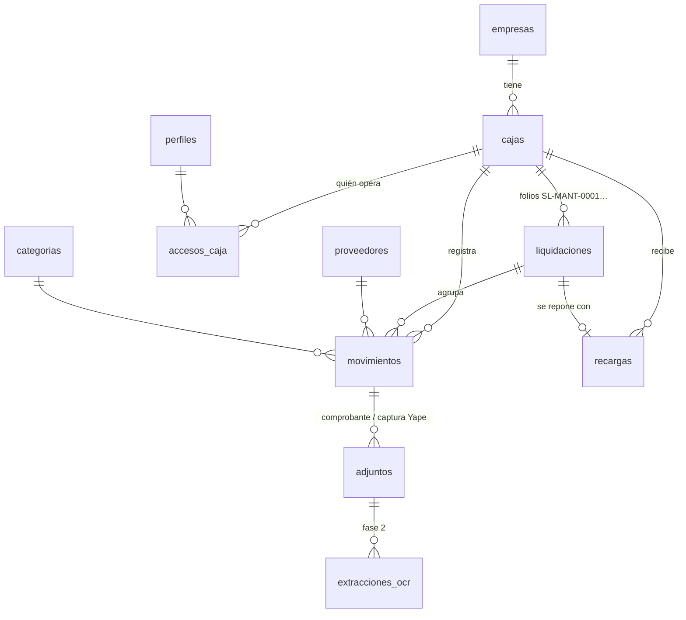
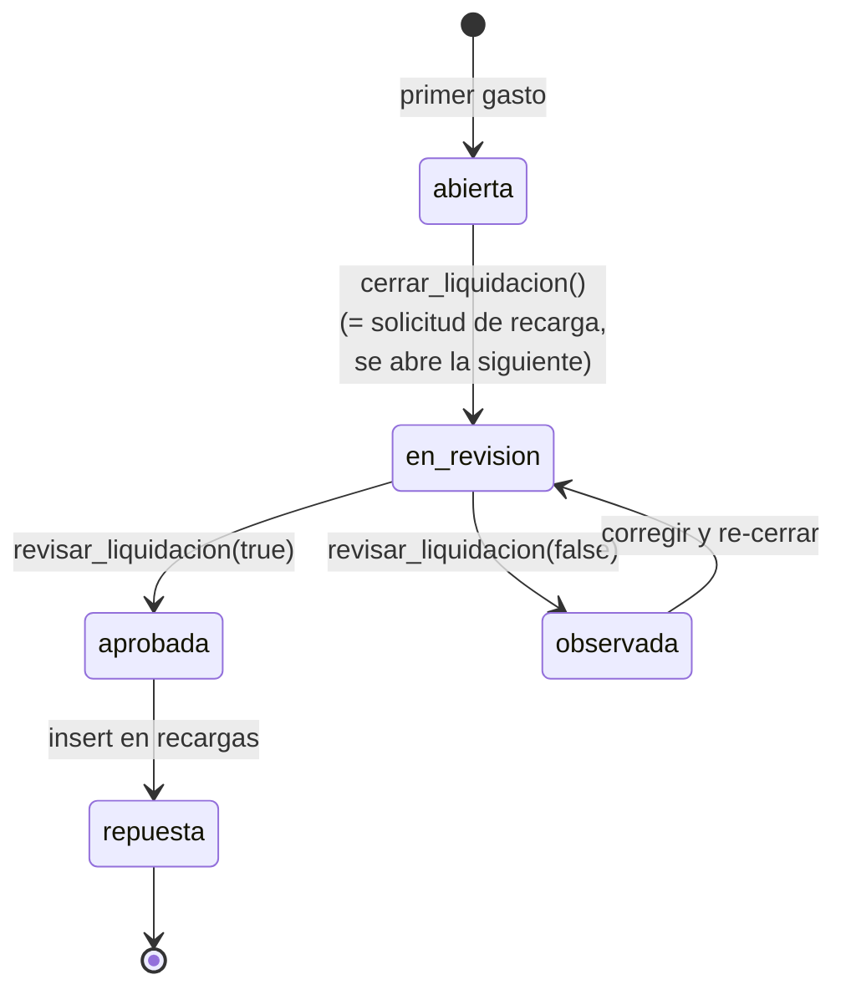

# Modelo de datos — Factudex

> Estado: **propuesta para aprobación**. SQL completo en
> [`supabase/migrations/20260925000000_esquema_inicial.sql`](../supabase/migrations/20260925000000_esquema_inicial.sql),
> datos de demo en [`supabase/seed.sql`](../supabase/seed.sql).

## Diagrama

## Principios

1. **El saldo no se guarda, se calcula.** `saldo = Σ recargas − Σ movimientos no anulados`
   (vista `v_saldo_cajas`). Así un gasto descuenta al instante y no hay saldos desincronizados.
2. **El estado Pendiente/Completo es un campo del movimiento**, mantenido por un trigger:
   pasa a `completo` en cuanto existe un adjunto de tipo `comprobante`. Una captura de Yape
   **no** completa el gasto (es prueba de pago, no sustento tributario).
3. **Nada se borra.** Los movimientos se *anulan* con motivo; las liquidaciones cerradas
   congelan sus movimientos (solo se les pueden seguir adjuntando documentos).
4. **Las transiciones de liquidación solo ocurren por RPC** (`cerrar_liquidacion`,
   `revisar_liquidacion`) y por el registro de la recarga; el cliente no puede cambiar `estado` directo.
5. **Montos** en `numeric(12,2)` (soles). **Fechas de negocio** en `date`, zona `America/Lima`.

## Tablas

### `empresas`
| Campo | Tipo | Nota |
|---|---|---|
| id | uuid PK | |
| codigo | text único | `SL`, `SIPE` — se usa en el folio |
| nombre_corto / razon_social | text | "San Lorenzo" / "Compañía San Lorenzo S.A.C." |
| ruc | char(11) | opcional |
| color_primario / color_acento | text `#RRGGBB` | tema dinámico del HUD |
| activa | bool | |

### `cajas`
| Campo | Tipo | Nota |
|---|---|---|
| id | uuid PK | |
| empresa_id | FK empresas | |
| codigo | text | `MANT`, `OPER`, `GEN` — único por empresa, va en el folio |
| nombre | text | "Mantenimiento" |
| fondo_fijo | numeric | monto al que se repone la caja (ej. S/ 2,000) |
| umbral_alerta | numeric | aviso cuando el saldo baja de aquí (ej. S/ 200) |
| responsable_id | FK perfiles | quien la liquida normalmente |

### `perfiles` (usuarios) y `accesos_caja` (roles)
`perfiles` es 1–1 con `auth.users` y se crea solo al registrarse (trigger).

| Rol | Alcance | Puede |
|---|---|---|
| `admin` | global (`perfiles.rol`) | todo: empresas, cajas, usuarios, maestros |
| `aprobador` | por caja (`accesos_caja.rol`) | lo del registrador + aprobar/observar liquidaciones + registrar recargas |
| `registrador` | por caja | registrar movimientos, adjuntar comprobantes, cerrar liquidación |
| `lector` | por caja | solo ver (ej. gerencia) |

Una persona puede ser registradora en una caja y aprobadora en otra. **Esto resuelve el
problema de origen**: si la persona habitual falta, se le da acceso a otra en minutos.

### `proveedores` (maestro compartido entre empresas)
| Campo | Tipo | Nota |
|---|---|---|
| tipo_doc | enum `RUC` \| `DNI` \| `CE` \| `OTRO` | |
| num_doc | text | RUC validado (11 dígitos, prefijo 10/15/17/20), DNI 8 dígitos. Único con `tipo_doc` |
| razon_social | text | |
| nombre_comercial | text | ej. "COVISOL - Peaje Chicama" |

Índice trigram sobre `razon_social + nombre_comercial + num_doc` para el autocompletado
("buscar por nombre o RUC"). Cualquier usuario puede crear un proveedor nuevo desde el registro;
solo admin edita.

### `categorias`
`nombre`, `orden`, `empresa_id` (null = global). Semilla: Peajes, Combustible, Repuestos y
ferretería, Llantas, Alimentación, Movilidad, Útiles de oficina, Servicios, Otros.

### `movimientos` (gastos)
| Campo | Tipo | Nota |
|---|---|---|
| caja_id | FK | no se puede cambiar después |
| liquidacion_id | FK | **automático**: la liquidación abierta de la caja (se crea si no hay) |
| fecha | date | fecha del gasto |
| solicitante | text | quién pidió el gasto |
| proveedor_id | FK, nullable | null = "Por definir" |
| categoria_id | FK, nullable | null = "Sin categorizar" |
| centro_costo | text | centro de costo o placa (ej. `T1Y-461`) |
| detalle | text | "Peaje pesado 3 ejes" |
| monto | numeric > 0 | |
| tipo_documento | enum `factura` \| `boleta` \| `rxh` \| `otro`, nullable | null = aún no se sabe |
| serie_numero | text | ej. `F001-00012345` |
| pagado_yape | bool | **independiente** del tipo de documento |
| estado | enum `pendiente` \| `completo` | lo mantiene el trigger de adjuntos |
| origen | enum `manual` \| `compartido` \| `ocr` | de dónde vino (métrica de adopción) |
| anulado / motivo_anulacion | | en vez de borrar |
| creado_por, created_at, updated_at | | auditoría |

### `adjuntos`
Archivos en Supabase Storage, bucket privado `comprobantes`, ruta
`<caja_id>/<movimiento_id>/<uuid>.<ext>` (el primer segmento permite aplicar RLS en Storage).

| Campo | Nota |
|---|---|
| tipo | `comprobante` (completa el movimiento) \| `captura_yape` \| `otro` |
| storage_path, mime_type, tamano_bytes | JPG/PNG/WEBP/HEIC/PDF, máx. 10 MB |

Un movimiento puede tener varios adjuntos (ej. captura de Yape hoy + factura la próxima semana).

### `liquidaciones`
| Campo | Nota |
|---|---|
| correlativo, folio | automáticos por caja: `SL-MANT-0001`, `SL-MANT-0002`… |
| estado | ver ciclo abajo |
| fecha_inicio, fecha_cierre | |
| total_gastado | snapshot al cerrar |
| cerrada_por/en, aprobada_por/en, observaciones | trazabilidad de quién hizo qué |

Solo puede haber **una liquidación abierta por caja** (índice único parcial).

La vista `v_liquidaciones` añade `total_actual`, `num_movimientos` y **`num_incompletos`**
(movimientos pendientes → se pintan en rojo en la liquidación).

### `recargas` (entradas)
| Campo | Nota |
|---|---|
| tipo | `apertura` (fondo inicial), `reposicion` (repone una liquidación aprobada), `ajuste` (corrección, puede ser negativo) |
| liquidacion_id | obligatorio en `reposicion`, único (una recarga por liquidación) |
| monto, fecha, medio, referencia (N° operación), nota | registro **manual** |
| registrado_por | el aprobador — queda quién y cuándo |

Sin integración bancaria: los bancos no exponen los abonos a cuentas personales sin contrato corporativo.

### `extracciones_ocr` (fase 2, estructura preparada)
Guarda cada lectura con IA: `storage_path`, `modelo`, `respuesta` (JSON validado con
[`src/lib/ocr/esquema.ts`](../src/lib/ocr/esquema.ts)), `error`, `aceptada`. Sirve para
auditar y medir precisión. **Nunca crea movimientos por sí sola.**

## Vistas

| Vista | Para |
|---|---|
| `v_saldo_cajas` | HUD: saldo por caja, `bajo_umbral`, n° de pendientes |
| `v_pendientes` | Módulo Pendientes: `dias_antiguedad` y `nivel_alerta` (`reciente` ≤3d, `atencion` 4–7d, `critico` >7d) |
| `v_liquidaciones` | Módulo Liquidaciones: totales e incompletos |

Todas con `security_invoker`, así respetan el RLS de quien consulta.

## Seguridad (RLS)

- RLS activado en **todas** las tablas. Helpers `security definer`: `es_admin()`,
  `tiene_acceso_caja(caja, rol_minimo)`, `tiene_acceso_empresa(empresa)`.
- Cada usuario ve solo empresas/cajas asignadas; admin ve todo.
- `movimientos`: insertar/editar requiere rol ≥ registrador en la caja; no hay `DELETE`.
- `adjuntos`: se pueden subir aunque la liquidación esté cerrada (para completar pendientes).
- `recargas`: solo aprobador de la caja.
- `liquidaciones`: solo lectura directa; los cambios pasan por las RPC.
- Storage `comprobantes`: el primer segmento de la ruta (`caja_id`) decide el acceso.
- El rol de un usuario nunca se puede autoasignar.

Verificado contra PostgreSQL 16 (con *stubs* de `auth`/`storage`): flujo completo
apertura → gastos → adjunto → cierre → aprobación → recarga, y rechazos de RLS
(caja ajena, registrador aprobando, auto-promoción a admin).

## Preguntas abiertas (para aprobar)

1. **Formato del folio**: la propuesta PDF dice `LIQ-SL-MANT-0001`, el pedido dice `SL-MANT-0001`. Implementado el segundo; es un cambio de una línea.
2. **¿Se puede aprobar una liquidación con movimientos pendientes?** Hoy se permite (se marcan en rojo). Alternativa: bloquear la aprobación.
3. **Días de alerta de pendientes**: 3 y 7 días propuestos.
4. **Fondo fijo y umbral por caja**: seed con S/ 2,000 y S/ 200 provisionales.
5. **Proveedores por empresa o compartidos**: propuesto compartido (el mismo RUC sirve a ambas).
6. **Centro de costo/placa**: texto libre con autocompletado de valores usados. ¿Se necesita un maestro de placas?
